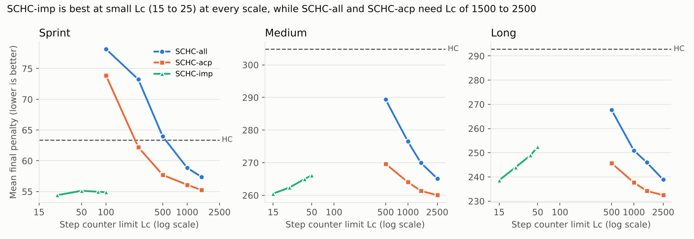

# Step Counting Hill Climbing for the Nurse Rostering Problem

[](https://github.com/The-Architeckts/schc-nurse-rostering/actions/workflows/ci.yml)

BSc (Hons) Computer Science dissertation, Bangor University, 2026. Awarded a First.
Supervisor: Dr Mosab Bazargani.

This repository contains the implementation, experimental pipeline, raw results, statistical
analysis and full write-up of a study applying the Step Counting Hill Climbing algorithm
(SCHC; Bykov and Petrovic, 2016) to the First International Nurse Rostering Competition
benchmark (INRC-I). It provides the first systematic evaluation of all three SCHC variants
on this benchmark.

* **Full dissertation:** [`dissertation/SCHC_NRP_Dissertation_revised.pdf`](dissertation/SCHC_NRP_Dissertation_revised.pdf) (revised edition, November 2026)
* **As submitted (May 2026), with errata:** [`dissertation/`](dissertation/)
* **Interactive results dashboard:** <https://the-architeckts.github.io/schc-nurse-rostering/>

---

## Headline findings

The three SCHC variants were compared against a Hill Climbing (HC) baseline on all 20 INRC-I
early instances (10 Sprint, 5 Medium, 5 Long), with a sweep over the step counter limit
Lc and 10 seeded runs per configuration. In total, 2,800 runs were performed, consuming
approximately 390 CPU-hours on the Supercomputing Wales Falcon cluster.

1. **All three SCHC variants significantly outperform Hill Climbing at every scale**, reducing
   mean penalty by 9.5 to 20.6 percent (Wilcoxon signed-rank, p < 0.001, effect size r > 0.84
   in every case).
2. **SCHC-acp is the most consistently effective variant.** It is best at Long scale and
   statistically equivalent to SCHC-imp at Medium scale (p = 0.27).
3. **SCHC-imp is best at Sprint scale**, and its optimal Lc is approximately scale-invariant
   (25 at Sprint, 15 at Medium and Long). The optimal Lc of SCHC-all and SCHC-acp instead
   grows with problem size (1500 to 2500).
4. **The scale-invariance of SCHC-imp is explained by the NRP landscape.** Improving moves make
   up roughly 1 percent of iterations, so the SCHC-imp counter advances slowly and its
   effective bound-update frequency decouples from the nominal Lc. As improving moves become
   rarer at Long scale, SCHC-imp falls back to statistical equivalence with SCHC-all
   (p = 0.92).

### Further findings from the post-submission SQL analysis

These come from the SQL queries added after submission (see
[Results database and SQL](#results-database-and-sql)) and are not in the dissertation.

5. **The advantage over HC holds run by run, not only on average.** Pairing each SCHC run at its
   optimal Lc with the HC run on the same instance and seed, every variant wins at least 96 of
   100 Sprint pairs and all 50 Medium and all 50 Long pairs (query 2).
6. **Returns on larger Lc diminish steeply.** For SCHC-acp at Long scale, raising Lc from 1500
   to 2500 improves mean penalty by 1.8 points at a cost of about 31 extra minutes per run,
   roughly 1,070 seconds per penalty point (query 3). SCHC-all and SCHC-acp were still improving
   at the largest Lc tested, so the optimum may lie beyond the tested range, but each further
   gain is expensive.
7. **For SCHC-imp, the optimum lies at the edge of the tested range.** Its best Lc at Medium and
   Long scale (15) is the smallest value tested, and penalty rises steadily with Lc above it, so
   its true optimum may be lower still.

Findings 6 and 7 suggest that the Lc sweeps should be extended in both directions, which
is a natural next experiment for this algorithm and problem.




### Results at the optimal Lc

Mean final penalty over all instances and runs at each scale (lower is better).

| Scale | HC | SCHC-all | SCHC-acp | SCHC-imp |
|---|---|---|---|---|
| Sprint (10 instances × 10 runs) | 63.40 | 57.38 (Lc 1500) | 55.24 (Lc 1500) | **54.41** (Lc 25) |
| Medium (5 × 10) | 304.86 | 265.16 (Lc 2500) | **260.04** (Lc 2500) | 260.52 (Lc 15) |
| Long (5 × 10) | 292.88 | 238.88 (Lc 2500) | **232.46** (Lc 2500) | 238.62 (Lc 15) |

Pairwise comparisons between variants (Wilcoxon signed-rank at optimal Lc):

| Scale | acp vs all | imp vs all | imp vs acp |
|---|---|---|---|
| Sprint | acp better, p < 0.001 | imp better, p < 0.001 | imp better, p < 0.001 |
| Medium | acp better, p < 0.001 | imp better, p < 0.001 | not significant, p = 0.27 |
| Long | acp better, p < 0.001 | not significant, p = 0.92 | acp better, p < 0.001 |

The full tables are in [`results/analysis/`](results/analysis/), and the report printed by
the analysis script is [`results/analysis/analysis_report.txt`](results/analysis/analysis_report.txt).

---

## The algorithm

SCHC is a single-parameter local search. It keeps a cost bound and accepts any candidate
whose penalty is strictly below that bound. Every Lc counted steps, the bound is reset to the
current penalty. The variants differ only in what is counted:

| Variant | Counter advances on |
|---|---|
| SCHC-all | every iteration |
| SCHC-acp | every accepted move |
| SCHC-imp | every improving move |

Termination rules (all empirically calibrated, see Section 3.6 of the dissertation):

* **HC:** stop after 2,000 consecutive non-improving iterations.
* **SCHC-all and SCHC-acp:** stop when the idle counter exceeds 100 and also exceeds 1 percent
  of total iterations. The idle counter resets on any accepted move.
* **SCHC-imp:** stop when no new best solution has been found for max(30000, 500 × Lc)
  iterations. The adaptive rule above cannot fire for SCHC-imp on the NRP, because rare bound
  updates keep the bound high, so non-improving moves keep being accepted and the idle
  counter keeps resetting.

The search starts from a feasible greedy construction and uses six swap-based neighbourhood
operators that preserve feasibility. Hard constraints (coverage and one shift per nurse per
day) are penalised at 10<sup>6</sup> per violation; the seven INRC-I soft constraint types
(counters, series, patterns, complete and identical weekends, shift-off and day-off requests)
make up the objective.

---

## Repository layout

```
├── dissertation/            Revised and submitted editions (PDF), errata, LaTeX source
├── src/                     Final implementation
│   ├── models.py            Nurse, contract and shift type definitions
│   ├── data_loader.py       INRC-I JSON instance loader
│   ├── solution.py          2D nurse × day solution representation
│   ├── constructors.py      Greedy feasible baseline constructor
│   ├── constraints.py       Hard and soft constraint evaluation (penalty function)
│   ├── operators.py         Neighbourhood operators
│   └── algorithms/
│       ├── hill_climbing.py
│       └── schc.py          SCHC with all three variants
├── experiments/
│   ├── run_instance_sweep.py    Runs HC + all SCHC variants over the Lc sweep for one instance
│   ├── slurm/                   Slurm job arrays used on Falcon (sprint, medium, long)
│   ├── analyse_results.py       Descriptive statistics and Wilcoxon tests
│   ├── build_database.py        Loads all runs into SQLite (results/schc_results.db)
│   ├── build_dashboard.py       Builds docs/index.html from the SQL queries
│   ├── plot_results.py          Figures shown above
│   ├── validate_penalty.py      Checks the penalty function against published best-known solutions
│   ├── generate_per_instance_table.py   Per-instance LaTeX table used in the dissertation
│   └── pre_sweep_validation.py  Verbose single-instance run used to check variant behaviour
├── results/
│   ├── raw/                 Per-instance results.csv and checkpoint logs from Falcon (2,800 runs)
│   ├── analysis/            Output of analyse_results.py
│   ├── schc_results.db      SQLite database of every run
│   └── figures/
├── sql/                     Database schema and the three analysis queries
├── docs/                    Results dashboard (GitHub Pages)
├── data/
│   ├── inrc1/               INRC-I instances (JSON)
│   └── toffolo_bks/         Best-known solutions used for penalty validation
├── tests/                   Test suite (see TESTING.md)
├── .github/workflows/       Continuous integration
└── archive/                 Earlier development work, kept for the record (see below)
```

---

## Reproducing the results

Python 3.12 is required. The algorithms use only the standard library; the analysis and
figures need the packages in `requirements.txt`.

```bash
pip install -r requirements.txt
```

**Quick checks (seconds):**

```bash
python -m pytest                        # full test suite, see TESTING.md
python experiments/validate_penalty.py  # penalty function vs published best-known solutions
python experiments/analyse_results.py   # regenerates results/analysis/ from results/raw/
python experiments/plot_results.py      # regenerates results/figures/
```

`analyse_results.py` reproduces every table in `results/analysis/` exactly from the raw CSVs.

**Rerunning the experiments.** Every run is seeded with its run number, and the code in
`src/` is the code that ran on Falcon, so rerunning an instance regenerates its row of
`results/raw/` exactly (apart from the wall-clock times). One instance at a time:

```bash
python experiments/run_instance_sweep.py sprint 1    # roughly 2.5 hours on one core
```

The full experiment is three Slurm job arrays, one task per instance:

```bash
sbatch experiments/slurm/submit_sprint_array.sh   # 10 tasks, about 2.5 h each
sbatch experiments/slurm/submit_medium_array.sh   # 5 tasks, about 20 h each
sbatch experiments/slurm/submit_long_array.sh     # 5 tasks, about 50 to 58 h each
```

Set `--account` in each script to your own project before submitting. On a single machine
the whole sweep would take around 390 CPU-hours, so a cluster, or a lot of patience, is
recommended.

---

## Results database and SQL

Every run is also available in a normalised SQLite database, `results/schc_results.db`
(schema: [`sql/schema.sql`](sql/schema.sql)), with tables for instances, algorithms and runs
and a summary view per configuration. Three queries answer the main questions of the study:

| Query | Question | Techniques |
|---|---|---|
| [`01_optimal_lc.sql`](sql/01_optimal_lc.sql) | Which Lc is optimal for each variant and scale, and how much does it beat HC by? | CTEs, `RANK()` window function, joins |
| [`02_head_to_head_vs_hc.sql`](sql/02_head_to_head_vs_hc.sql) | Paired by instance and seed, how often does each variant beat HC? | Chained CTEs, self-join of the runs table, conditional aggregation |
| [`03_cost_quality_tradeoff.sql`](sql/03_cost_quality_tradeoff.sql) | What does each step up in Lc cost in run time, and what does it buy? | `LAG()` over a named window |

```bash
sqlite3 results/schc_results.db < sql/02_head_to_head_vs_hc.sql
```

The [dashboard](https://the-architeckts.github.io/schc-nurse-rostering/) is generated from these
queries by `experiments/build_dashboard.py` and has no external dependencies. To rebuild both:

```bash
python experiments/build_database.py
python experiments/build_dashboard.py
```

Query 2 adds a finding that the mean comparisons do not show directly: at the optimal Lc, each
SCHC variant beats HC in at least 96 of 100 paired Sprint runs and in every paired Medium and
Long run. Query 3 quantifies the diminishing returns of larger Lc: for SCHC-acp at Long scale,
the final step from Lc 1500 to 2500 costs about 1,070 extra seconds per penalty point gained.

---

## Testing

The test suite checks that every reported number can be regenerated from the code and raw data,
and runs on every push through GitHub Actions. It covers the penalty function, exact reproduction
of Falcon runs from their seeds, database integrity, agreement between the SQL queries and the
independent pandas analysis, and freshness of all committed outputs. See
[`TESTING.md`](TESTING.md) for what each test protects against.

```bash
python -m pytest
```

---

## Validity notes and limitations

* **Penalty function and absolute values.** On the published best-known solutions of Toffolo et
  al., this project's evaluator agrees to within 0 to 7 points, always under-penalising
  (`experiments/validate_penalty.py`). However, the best solutions found in this study score
  below the published best-known values on all ten Sprint and Long instances where these are
  compared, which strongly suggests the evaluator misses some violations that the searches
  learned to exploit. **Comparisons between the algorithms here are unaffected**, since all use
  the same evaluator, but absolute penalties and comparisons with other published methods
  should not be relied on. See item 5 of [`dissertation/ERRATA.md`](dissertation/ERRATA.md).
* **Lc range.** For SCHC-all and SCHC-acp, the best Lc found at every scale is the largest
  value tested (1500 at Sprint, 2500 at Medium and Long), and the curves above are still
  falling there. Larger Lc may give further gains at proportionally higher cost; the reported
  optimum is the best value within the tested range. Conversely, the best SCHC-imp value at Medium and Long scale is the
  smallest tested (15), so its true optimum there may lie lower still.
* **Statistics.** Comparisons pair runs by instance and seed. The effect size r is derived
  from the normal approximation of the Wilcoxon p-value, as r = |Z| / √N. Runs on the same
  instance are not fully independent, so the p-values are likely to overstate the evidence
  somewhat; the direction of every main effect is, however, consistent across instances.
* **Errata.** Several statements in the submitted dissertation differ from the final results
  and code, which take precedence. They are listed in
  [`dissertation/ERRATA.md`](dissertation/ERRATA.md) and corrected in the revised edition.

---

## Project history

Only the work described above reflects the final results. The project went through several
earlier stages, including results produced by implementations of the SCHC variants that were
later found to be incorrect. That material is kept in [`archive/`](archive/), together with a
timeline of how the work developed.

> **The conference-style poster in `archive/poster/` (March 2026) reports findings that were
> later disproven.** It was produced from the earlier, flawed implementation and does not
> reflect the final results. Please refer to this README and the dissertation instead.

The first 16 commits in this repository's history are the original development commits from
February 2026. The final experiments were run on the Falcon HPC cluster from April 2026 and
were added to version control after the project was completed.

---

## Citation

```
Armstrong, A. (2026). Step Counting Hill Climbing: Application to the Nurse Rostering
Problem. BSc dissertation, School of Computer Science and Electronic Engineering,
Bangor University.
```

## Acknowledgements

Supervised by Dr Mosab Bazargani. The Medium and Long experiments were made possible by
Supercomputing Wales and the Cardiff University Falcon HPC cluster, funded by the European
Regional Development Fund and the Welsh Government.

INRC-I instances: Haspeslagh, De Causmaecker, Schaerf and Stølevik (2014), *The first
international nurse rostering competition 2010*, Annals of Operations Research 218(1).
Best-known solutions: Toffolo et al., <https://benchmark.gent.cs.kuleuven.be/nrp>.

## Use of AI tools

This project was conceived, designed and directed by me. The research questions,
experimental design, choice of algorithm variants and parameter ranges, code architecture,
execution of all experiments on the Falcon HPC cluster, debugging, and the interpretation of
the results are my own, as are all key research decisions.

Claude, an AI model developed by Anthropic, was used during development as an implementation
and debugging aid. It generated snippets of code to my specification and within my own
design, helped to diagnose errors, and assisted in examining experimental output to trace
problems to their source. All AI-assisted code was reviewed, understood and validated by me
before use. Its role was to accelerate implementation, so that a project of this scope
could be completed within the time available; it did not determine the direction or content
of the research.

After submission, Claude also assisted in preparing this repository for publication. That
work included organising the material, drafting documentation, building the SQLite database,
dashboard and continuous integration, and auditing the dissertation against the final results,
which produced the corrections listed in `dissertation/ERRATA.md`.

## Licence

The source code is released under the MIT Licence (see [`LICENSE`](LICENSE)). The
dissertation and poster are © Arthur Armstrong and are included for reading and reference;
please cite them if you use their content.
